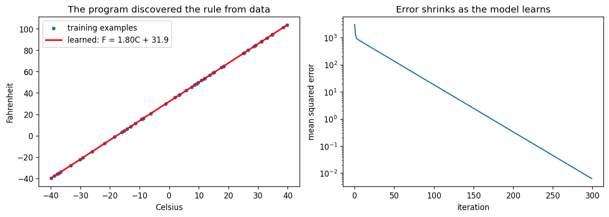
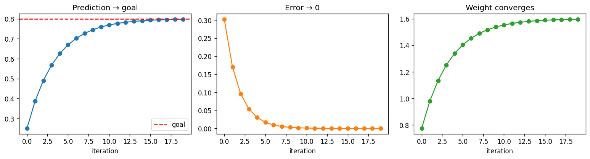
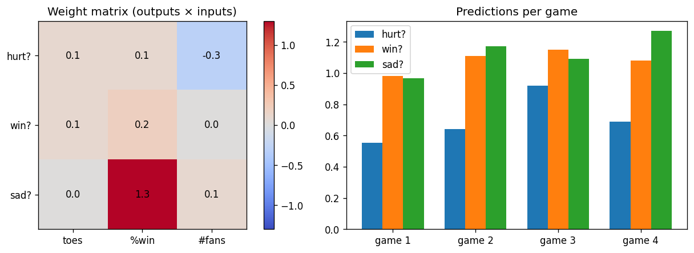
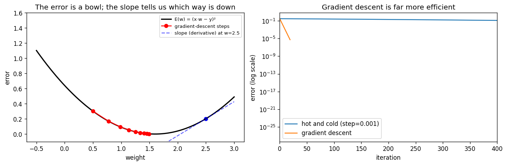
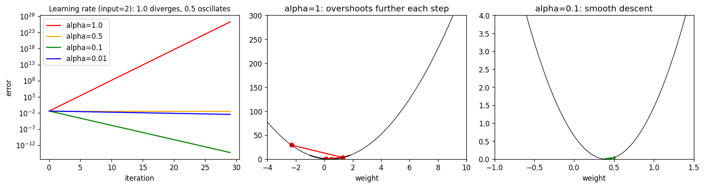
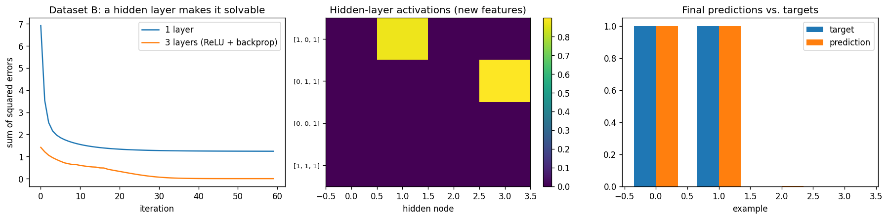
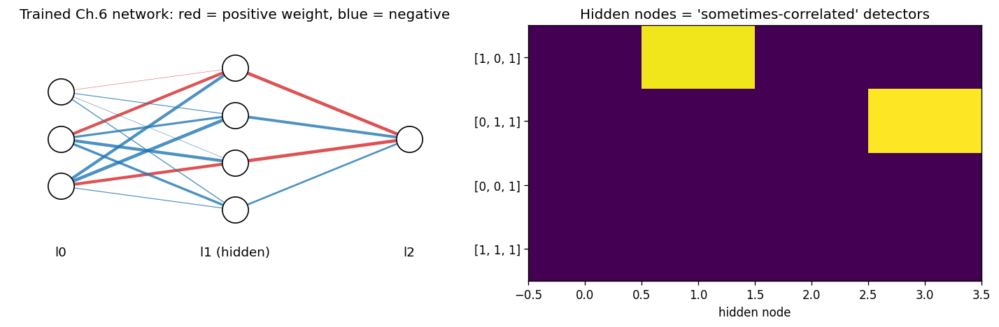
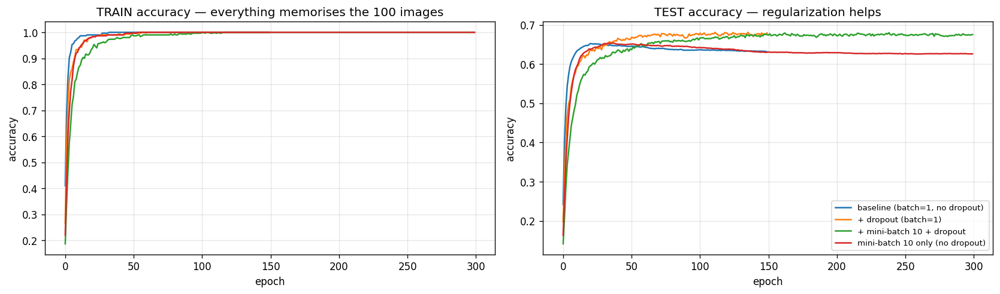
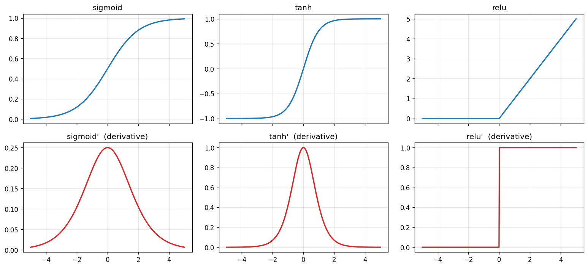
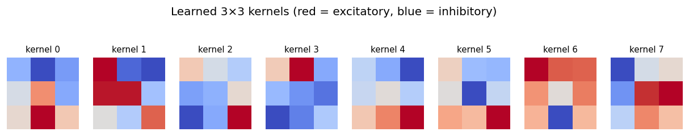

# Grokking Deep Learning

## Repository structure

```
GrokkingDeepLearning/
├── 01.introduction.ipynb
├── 02.Fundamental-Concepts.ipynb
├── 03.making-predictions.ipynb
├── 04.gradient-descent.ipynb
├── 05.learning.ipynb
├── 06.first-deep-network.ipynb
├── 07.big-picture.ipynb
├── 08.regularization.ipynb
├── 09.activation-functions.ipynb
├── 10.cnn.ipynb
├── folder-picture/        # every figure generated by the notebooks
├── requirements.txt
└── README.md
```

## How to run

```bash
pip install -r requirements.txt
jupyter notebook          # open any notebook and "Run All"
```
All notebooks are already executed, so the outputs and plots can be read directly on GitHub.

> **Dataset note (Chapters 8–10).** The book uses MNIST (downloaded from the internet). To keep the notebooks self-contained and offline, they use scikit-learn's built-in `load_digits` (8×8 handwritten digits) with a little Gaussian pixel noise and a small training set so that overfitting and regularization are clearly visible. The algorithms are the same as in the book; to use real MNIST, swap the data-loading cell and change the input size from 64 to 784.

---

## Chapter-by-chapter overview

| # | Notebook | Topic | One-line idea |
|---|---|---|---|
| 1 | [01.introduction](01.introduction.ipynb) | Introduction | Why deep learning, what you need, and learning a rule from data instead of coding it |
| 2 | [02.Fundamental-Concepts](02.Fundamental-Concepts.ipynb) | Fundamental concepts | Parametric vs non-parametric, supervised vs unsupervised, **predict → compare → learn** |
| 3 | [03.making-predictions](03.making-predictions.ipynb) | Forward propagation | A network = weighted sums; vector-matrix multiplication; stacked layers |
| 4 | [04.gradient-descent](04.gradient-descent.ipynb) | Measuring error & learning | Squared error, hot-and-cold learning, first gradient descent |
| 5 | [05.learning](05.learning.ipynb) | Generalized gradient descent | Learning rate α, divergence, many inputs/outputs, frozen weights, weight visualisation |
| 6 | [06.first-deep-network](06.first-deep-network.ipynb) | First deep network | Correlation, hidden layers, ReLU, **backpropagation** |
| 7 | [07.big-picture](07.big-picture.ipynb) | Picturing neural networks | Correlation summarization, circles-and-lines diagrams, letter notation |
| 8 | [08.regularization](08.regularization.ipynb) | Regularization & batching | Overfitting, early stopping, **dropout**, mini-batch gradient descent |
| 9 | [09.activation-functions](09.activation-functions.ipynb) | Activations & probabilities | sigmoid / tanh / relu, **softmax**, cross-entropy |
| 10 | [10.cnn](10.cnn.ipynb) | Convolutional networks | Shared kernels, feature maps, edge/corner detectors |

### Chapter 1 — Introduction
Motivation and orientation: AI ⊃ machine learning ⊃ deep learning, why deep learning is simpler than it looks (weighted sums, non-linearities, derivatives), and why we build it from scratch with NumPy. The notebook demonstrates the key idea by letting a program *discover* the Celsius→Fahrenheit rule from examples.



### Chapter 2 — Fundamental Concepts
Machine learning vocabulary: supervised vs unsupervised learning, parametric (fixed knobs, e.g. neural nets) vs non-parametric (stores/counts the data, e.g. k-NN) models, and the loop used by the whole book: **predict → compare → learn**.



### Chapter 3 — Making Predictions (Forward Propagation)
A prediction is `input × weight`; with many inputs it is a **dot product**, with many outputs it is a **weight matrix**, and hidden layers are "predictions on predictions". Includes pure-Python and NumPy implementations.



### Chapter 4 — Evaluating Predictions (Gradient Descent)
Error is measured with the squared difference (a bowl-shaped function of the weight). **Hot-and-cold** learning works but is slow; **gradient descent** uses the derivative to get the direction *and* amount of each update.



### Chapter 5 — Learning
Gradient descent in full: `weight -= alpha * delta * input`. The **learning rate** prevents divergence; multiple inputs/outputs give one gradient per weight (an outer product); frozen weights show how others compensate; weights can be visualised as images.



### Chapter 6 — Your First Deep Network
The streetlight problem: a one-layer network only finds **direct correlation** and fails on the XOR-like dataset. A **hidden layer + ReLU** creates intermediate correlation, and **backpropagation** (`delta_1 = delta_2 · W₂ᵀ × relu'`) teaches it. Stacked linear layers without ReLU collapse to one layer.



### Chapter 7 — The Big Picture
How to think about networks: *neural networks search for direct and indirect correlation between input and output*. Layers = vectors (rows of circles), weights = matrices (lines), a full training step in a few lines of algebra, and "(layer before)ᵀ · (delta after)" as the universal weight update.



### Chapter 8 — Regularization and Batching
A network can *memorise* its training data (100 % train accuracy but much lower test accuracy). Remedies: early stopping, **dropout** (random mask ×2 in training, off at test time) and **mini-batch** gradient descent. In our experiment dropout clearly improves test accuracy.



### Chapter 9 — Activation Functions
What makes a valid activation (continuous, monotonic, non-linear, cheap), the classical sigmoid / tanh / relu with their derivatives, **softmax** for "exactly one class", and **cross-entropy** whose gradient is simply `p − y` (verified numerically). Final model: tanh + softmax + dropout + mini-batches.



### Chapter 10 — Convolutional Neural Networks
Re-use a small kernel at every image position (weight sharing). A from-scratch convolutional layer (`expanded_input @ kernels`), back-propagation that *sums* the kernel gradient over all positions, learned kernels and feature maps, and a comparison with the dense network (higher test accuracy with ~7× fewer parameters in our run).



---

## Reference
Andrew W. Trask, *Grokking Deep Learning*, Manning Publications — <https://www.manning.com/books/grokking-deep-learning>
